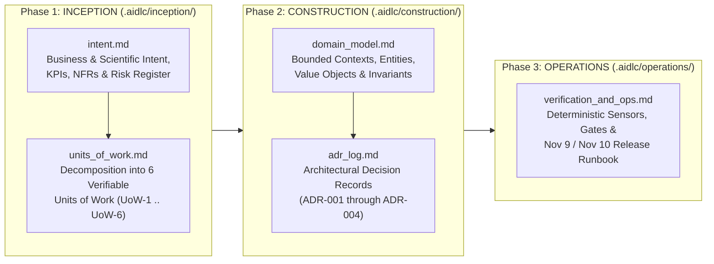

# AWS AI-Driven Development Life Cycle (AI-DLC v2) — Project Workspace

**Reference Implementation:** [`awslabs/aidlc-workflows` v2.11.3](https://github.com/awslabs/aidlc-workflows) (`external_repos/aidlc-workflows`)  
**Project:** Google Mumbai Air Quality Forecasting Challenge & VayuDrishti Mumbai (`2026`)  
**Core Tenets:** *The human drives the engine. Tools for determinism. LLM for knowledge. Human for judgement.*

---

## 1. AI-DLC v2 Lifecycle Architecture

Following AWS Labs' **AI-Driven Development Life Cycle (AI-DLC v2)** specification, this project connects intent, domain modeling, architectural decisions, implementation units, and operational verification gates through three structured phases:

---

## 2. Artifact Index

| Phase | Artifact Path | Description |
| :--- | :--- | :--- |
| **Inception** | [`.aidlc/inception/intent.md`](inception/intent.md) | Captures the dual-track competition intent ($2,500 Track 1 Forecasting Leaderboard + $500 Track 2 Creative Award), success metrics, non-functional requirements (NFRs), and anti-leakage constraints. |
| **Inception** | [`.aidlc/inception/units_of_work.md`](inception/units_of_work.md) | Decomposes the system into 6 independently testable Units of Work (`UoW-1` through `UoW-6`) with explicit inputs, outputs, file boundaries, and verification sensors. |
| **Construction** | [`.aidlc/construction/domain_model.md`](construction/domain_model.md) | Domain-Driven Design (DDD) specification of bounded contexts, entities (`Station`, `ForecastCutoff`, `ValidationFold`, `BMCWard`, `VulnerableFacility`), value objects, and mathematical invariants. |
| **Construction** | [`.aidlc/construction/adr_log.md`](construction/adr_log.md) | Source-bound Architectural Decision Records (`ADR-001` 100% Colab Reproducibility, `ADR-002` Compact `V=4/V=12` `TimesFM 3.0`, `ADR-003` $\tanh$-Saturating Synoptic-Diurnal CAMS MOS, `ADR-004` Trapezoidal Quantile Expectation under RMSE). |
| **Operations** | [`.aidlc/operations/verification_and_ops.md`](operations/verification_and_ops.md) | Deterministic sensor commands, 6-point Zindi submission verification gate, and the step-by-step operational runbook for the Nov 9 update and Nov 10 `09:00 IST` final release. |
