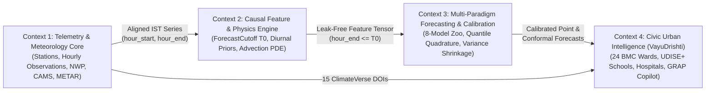

# AI-DLC Phase 2 (Construction): Domain Model & Invariants (`domain_model.md`)

**Lifecycle Stage:** `Construction -> Domain-Driven Design (DDD)`  
**Status:** `APPROVED`

---

## 1. Bounded Contexts

---

## 2. Core Domain Entities & Value Objects

### 2.1 `Station` (Entity)
- **Identity:** `location_id: int`
  - **Target Set ($\mathcal{S}_{\text{target}}$, $|\mathcal{S}_{\text{target}}| = 4$):** `11606` (*Borivali East - IITM*), `11611` (*Malad West - IITM*), `3409510` (*Byculla - BMC*), `3409511` (*Shivaji Nagar - BMC*).
  - **Auxiliary Set ($\mathcal{S}_{\text{aux}}$, $|\mathcal{S}_{\text{aux}}| = 14$):** `3409329` (*Deonar*), `3409483` (*Chembur*), `3409513` (*Sewri*), `3409328` (*BKC IITM*), `3409482` (*BKC MPCB*), `6959` (*Worli*), `6945` (*Kurla*), `6948` (*Airport T2*), `6927` (*Colaba*), `6956` (*Powai*), `12040` (*Mulund West*), `3409514` (*Ghatkopar*), `3409479` (*Mindspace Malad*), `6965` (*Borivali East MPCB*).
- **Attributes:** `latitude: float`, `longitude: float`, `ward_code: str`, `alphaearth_roughness: float` (`doi:10.71646/GHSZ7J`), `alphaearth_green_idx: float`, `open_buildings_density: float` (`doi:10.71646/EV3RBJ`), `coastal_dist_km: float`, `deonar_dist_km: float`.

### 2.2 `HourlyInterval` (Value Object)
- **Attributes:** `hour_start: pd.Timestamp` (`tz="Asia/Kolkata"`), `hour_end: pd.Timestamp` (`tz="Asia/Kolkata"`).
- **Domain Invariant (`INV-TIME`):**
  $$\texttt{hour\_end} - \texttt{hour\_start} \equiv 1\text{ hour}, \qquad \texttt{hour\_start.tz} == \texttt{ZoneInfo("Asia/Kolkata")}$$
  - For `Train.csv`: `hour_end = timestamp_ist`, `hour_start = hour_end - 1h`.
  - For `Test.csv`: `hour_start = target_start_ist`, `hour_end = target_end_ist`.

### 2.3 `ForecastCutoff` ($T_0$, Entity / Aggregate Root for Feature Construction)
- **Identity:** `cutoff_t0: pd.Timestamp` (`tz="Asia/Kolkata"`).
- **Domain Invariant (`INV-CAUSAL`):** An observation $o_{s,t}$ with interval $[t_{\text{start}}, t_{\text{end}}]$ belongs to the admissible history $\mathcal{H}(T_0)$ if and only if:
  $$t_{\text{end}} \le T_0$$
  Any target observation with $t_{\text{end}} > T_0$ is strictly invisible to all priors, rolling statistics, lag lookups, and RevIN normalizers anchored at $T_0$.

### 2.4 `AtmosphericState` (Value Object)
- **Attributes:** `pblh_m: float`, `wind_speed_10m: float`, `wind_dir_from_deg: float`, `u10: float`, `v10: float`, `onshore_breeze: float`, `deonar_wind_cos: float`, `thane_creek_wind_cos: float`, `ventilation_coeff: float`, `cams_pm25: float`, `cams_rel_factor: float`.
- **Domain Invariant (`INV-PHYSICS`):**
  $$\text{VC} = \max(\text{PBLH}, 15.0) \times \max(w_{10\text{m}}, 0.1) > 0, \qquad u_{10} = -w_{10\text{m}}\sin\theta_{\text{from}}, \qquad v_{10} = -w_{10\text{m}}\cos\theta_{\text{from}}$$

### 2.5 `BMCWard` & `VulnerableFacility` (Entities in `VayuDrishti Mumbai`)
- **`BMCWard` (`24` wards, `Wards A`..`T`, `doi:10.71646/EREDWQ`):** Aggregates population (`pop_2026`, `doi:10.71646/AAGK0G`), vulnerable pediatric/geriatric fractions (`vuln_children_pct`, `vuln_elderly_pct`), `maharera_sites` (`doi:10.71646/4ULQRE`), `udise_schools` (`doi:10.71646/XJIY8W`), `civic_hospitals` (`doi:10.71646/1XSUVR`), and interpolated `pm25_ugm3` into a deterministic `grap_stage` (`Watch`, `Stage I`, `Stage II`, `Stage III`).
