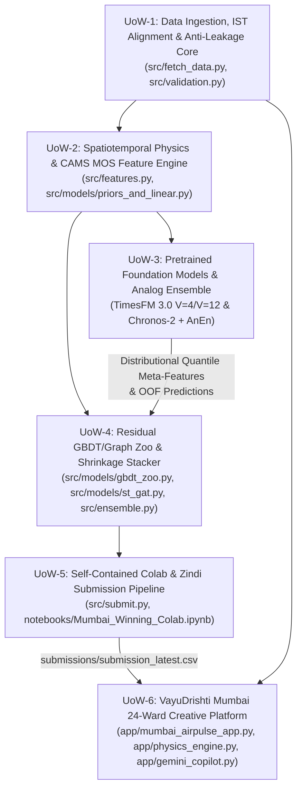

# AI-DLC Phase 1 (Inception): Units of Work Decomposition (`units_of_work.md`)

**Lifecycle Stage:** `Inception -> Work Decomposition`  
**Pattern:** Independently verifiable, loosely coupled Units of Work (`UoW-1` through `UoW-6`)

---

## 1. Dependency Graph of Units of Work

---

## 2. Detailed Unit Specifications & Verification Sensors

### `UoW-1`: Data Ingestion, IST Alignment & Anti-Leakage Core
- **Owned Files:** `src/fetch_data.py`, `src/validation.py`
- **Responsibilities:**
  - Sync `Train.csv` (`25,204` rows), `Test.csv` (`2,592` rows), `Stations.csv`, and `AdditionalHistory.zip` via Zindi SDK or Hugging Face (`han-jisso/google-mumbai-air-quality-challenge`).
  - Fetch and cache `open_meteo_weather.parquet`, `open_meteo_air_quality.parquet`, `vabb_metar_hourly.parquet` (strictly excluding visibility/wxcodes), and `climateverse_catalog.json` (`15` DOIs).
  - Reconcile the 1-hour timestamp convention (`train["hour_start"] = train["hour_end"] - 1h` vs `test["hour_start"] = test["target_start_ist"]` in `Asia/Kolkata`).
  - Implement 2-stage target outlier cleaning (`clean_pm25`: `flag_high_1000` / `>450 µg/m³` hardware glitch mask + 7-hour `4.5 MAD` Hampel filter) and the 5-Fold Post-Monsoon Rolling 48h Validation splits (`get_rolling_validation_splits`).
- **Verification Sensor:** `uv run python src/validation.py` (Asserts `hist_df["hour_end"].max() <= cutoff_t0 < val_start` across all folds and `0` nulls in cleaned targets).

### `UoW-2`: Spatiotemporal Physics & CAMS MOS Feature Engine
- **Owned Files:** `src/features.py`, `src/models/priors_and_linear.py`
- **Responsibilities:**
  - Construct `85+` strictly leak-free features for any `cutoff_t0`: multi-scale Empirical Bayes diurnal priors ($\tau_{1/2} = 120\text{h}, 36\text{h}, 18\text{h}$), exact autoregressive lags (`0h..24h`), cross-station spatial context (`4` target + `14` auxiliary stations), Ventilation Coefficient ($\text{VC} = \text{PBLH} \times w_{10\text{m}}$), onshore sea-breeze vector ($285^\circ$), Deonar ($75^\circ$) and Thane Creek ($110^\circ$) plume alignment cosines, weather anomalies relative to $T_0$, and multi-year DOY seasonal climatology (`2018–2025`).
  - Implement `Model 1` (`CalibratedDiurnalCAMSPriorForecaster` with `TimeMixer` synoptic-diurnal decomposition and $\tanh$-saturating CAMS MOS) and `Model 2` (`HuberRidgePhysicsGAMForecaster` with periodic hour B-splines and Duan's smearing).
- **Verification Sensor:** `uv run python src/features.py` (Asserts `0` NaN values across all `2,592` test rows).

### `UoW-3`: Pretrained Time-Series Foundation Models & Analog Ensemble (`Model 7` & `Model 8`)
- **Owned Files:** `external_repos/timesfm/`, `external_repos/chronos-forecasting/`, `notebooks/Mumbai_Winning_Colab.ipynb`
- **Responsibilities:**
  - `Model 7`: Execute `Google Research TimesFM 3.0 (330.71M)` (`google/timesfm-3.0-pytorch`) in Compact Multi-View (`V=4` Pure Target Multivariate + `V=12` Physics-Coupled `[4 targets + 4 CAMS + 4 log1p_vc]`, `use_znorm=False, padding_mode="edge"`) with 9-decile trapezoidal expectation.
  - `Model 8`: Execute `Amazon Chronos-2 (120M)` (`amazon/chronos-2`, `cross_learning=True` `GroupSelfAttention` + dict-based `future_covariates`, 21-quantile trapezoidal expectation) blended with the `MeteorologicalAnalogForecaster (AnEn)` ($k=15$ historical trajectory matcher).
  - Export distributional quantile meta-features (`E[Y|X]`, `q80 - q20` IQR, upper-tail skewness) to `UoW-4`.
- **Verification Sensor:** Trapezoidal weights sum to `1.0`; `V=4` and `V=12` outputs contain `0` NaNs and strictly outperform median ($q_{0.50}$) extraction under RMSE.

### `UoW-4`: Tabular/Graph Residual Zoo & Shrinkage Stacker (`Models 3–6` & `Ensemble`)
- **Owned Files:** `src/models/gbdt_zoo.py`, `src/models/st_gat.py`, `src/ensemble.py`
- **Responsibilities:**
  - Train `Model 3` (`LightGBMResidualForecaster`, `deterministic=True`), `Model 4` (`CatBoostResidualForecaster`, oblivious depth-5 trees), `Model 5` (`XGBoostResidualForecaster`, hist depth-4 trees), and `Model 6` (`WindGuidedSTGATForecaster`, PyTorch dynamic wind-advection graph attention network) on multi-cutoff residuals over `Model 1`.
  - Optimize simplex stacking weights via `SLSQP` + `Nelder-Mead` and calibrate station-specific horizon-decaying variance shrinkage $\alpha_s(h_{\text{lead}})$.
- **Verification Sensor:** `uv run python src/ensemble.py` (Asserts 24h OOF RMSE `< 10.75 µg/m³` and 72h OOF RMSE `< 10.40 µg/m³`).

### `UoW-5`: Self-Contained Colab & Zindi Submission Pipeline
- **Owned Files:** `src/submit.py`, `notebooks/Mumbai_Winning_Colab.ipynb`, `notebooks/Mumbai_Winning_Solution.ipynb`
- **Responsibilities:**
  - Train final ensemble on full `Train.csv`, execute **Known-Row Lookup** for any test `(location_id, hour_start)` already present in `Train.csv`, run the 6-point Zindi submission verifier, write `submissions/submission_latest.csv`, and support direct upload via `zindi` SDK (`--upload`).
- **Verification Sensor:** `uv run python src/submit.py` (Verifies all 6 Zindi assertions on disk).

### `UoW-6`: VayuDrishti Mumbai (`Mumbai AirPulse AI`) Creative Platform
- **Owned Files:** `app/mumbai_airpulse_app.py`, `app/physics_engine.py`, `app/spatial_catalog.py`, `app/gemini_copilot.py`, `app/README_CREATIVE_SUBMISSION.md`
- **Responsibilities:**
  - Deliver the 4-tab Streamlit decision-support platform featuring 18-station + 24-ward anisotropic wind-advected + `AlphaEarth 10m` kriging, 80%/95% split-conformal fan charts, WorldPop 2026 + UDISE+ school + BMC hospital exposure audits, and the Google Gemini 2.5 Flash BMC GRAP Copilot.
- **Verification Sensor:** `uv run streamlit run app/mumbai_airpulse_app.py --server.headless true` (Zero import or runtime errors).
