# Software & UI/UX Design Specification (`DESIGN.md`)

**Project:** Google Mumbai Air Quality Forecasting Challenge & VayuDrishti Mumbai (`2026`)  
**Scope:** Module interfaces, data schemas, Streamlit 4-tab layout, Folium/Plotly GIS layers, Gemini 2.5 Flash GRAP Copilot architecture, and Google Colab notebook structure.

---

## 1. Repository & Package Component Architecture

```
/Volumes/MacExt/Projects/google-mumbai-air-quality/
├── src/                                  # Track 1: Core Forecasting & Submission Pipeline
│   ├── __init__.py
│   ├── fetch_data.py                     # Zindi SDK / HF Hub + Open-Meteo NWP + CAMS + VABB METAR + ClimateVerse API
│   ├── validation.py                     # IST alignment, 2-stage Hampel cleaner (`clean_pm25`), 5-fold rolling splits
│   ├── features.py                       # `ExternalDataStore`, `build_features_for_cutoff`, `build_multi_cutoff_training_dataset`
│   ├── ensemble.py                       # `StackedAirQualityEnsemble`, SLSQP + Nelder-Mead OOF optimizer, CV leaderboard
│   ├── submit.py                         # Final training, Known-Row Lookup, 6-point verifier, Zindi SDK uploader
│   └── models/
│       ├── __init__.py
│       ├── priors_and_linear.py          # Model 1 (`CalibratedDiurnalCAMSPriorForecaster`) & Model 2 (`HuberRidgePhysicsGAMForecaster`)
│       ├── gbdt_zoo.py                   # Model 3 (`LightGBM`), Model 4 (`CatBoost`), Model 5 (`XGBoost`)
│       └── st_gat.py                     # Model 6 (`WindGuidedSTGATForecaster` & `WindGuidedGATNet` in PyTorch)
├── app/                                  # Track 2: VayuDrishti Mumbai (Mumbai AirPulse AI) Streamlit Platform
│   ├── __init__.py
│   ├── mumbai_airpulse_app.py            # Main 4-Tab Streamlit UI (Folium GIS + Plotly Mapbox + Conformal Fan + Copilot)
│   ├── physics_engine.py                 # Anisotropic wind-advected kriging, Hampel filter, conformal intervals
│   ├── spatial_catalog.py                # 18 CAAQMS stations, 24 BMC Wards, 6 Hotspots, 10 Facilities, 15 ClimateVerse DOIs
│   ├── gemini_copilot.py                 # Google `google-genai` (`gemini-2.5-flash`) + deterministic BMC GRAP fallback
│   └── README_CREATIVE_SUBMISSION.md     # Track 2 creative submission documentation
├── notebooks/                            # Self-Contained Reproducible Notebooks for Top-10 Code Review
│   ├── Mumbai_Winning_Solution.ipynb     # Full EDA, 5-Fold CV ablation, 8-Model Zoo, SHAP/Physics interpretability
│   └── Mumbai_Winning_Colab.ipynb        # 100% self-contained Google Colab T4 GPU execution notebook
├── external_repos/                       # Cloned Verified FOSS Reference Repositories
│   ├── timesfm/                          # Google Research TimesFM 3.0 (`src/timesfm3/torch`) & 2.5
│   ├── chronos-forecasting/              # Amazon Chronos-2 (`src/chronos/chronos2`) & Chronos-Bolt
│   ├── TabPFN/                           # PriorLabs TabPFN v2 / v2.5
│   ├── TimeMixer/                        # ICLR 2024 Past-Decomposable-Mixing & Future-Multipredictor-Mixing
│   ├── AirPhyNet/                        # ICLR 2024 Physics-Guided Advection-Diffusion PDE Network
│   ├── PM2.5-GNN/                        # Domain-Knowledge Wind-Directed Graph Neural Network
│   ├── Layer.ai-Air-Quality-Prediction-Challenge/
│   ├── climateverse_mcp/                 # ClimateVerse Dataverse MCP Client
│   ├── google-colab-cli/                 # Headless Google Colab CLI (`colab`)
│   └── aidlc-workflows/                  # AWS Labs AI-DLC v2 Methodology Reference
└── .aidlc/                               # AWS AI-DLC v2 Artifacts (Inception, Construction, Operations)
```

---

## 2. Core Data Schemas & Module Interfaces (`src/`)

### 2.1 Aligned Core Dataframes (`src/validation.py:load_and_align_core_data`)
- **`train_df` (`25,204` rows $\times$ `14` columns):**
  - Primary Key: `(location_id: int, hour_start: datetime64[ns, Asia/Kolkata])`
  - Timestamp Columns: `timestamp_ist` (raw string), `hour_end` (`timestamp_ist` in IST), `hour_start` (`hour_end - 1h`), `target_start_ist` (`== hour_start`).
  - Target & Cleaning Columns: `pm25` (raw competition target), `pm25_raw`, `pm25_clean` (2-stage Hampel-cleaned target), `flag_high_1000: bool`, `is_glitch_stage1: bool`, `is_spike_stage2: bool`, `is_outlier: bool`.
- **`test_df` (`2,592` rows $\times$ `11` columns):**
  - Primary Key: `ID: str` (format `"{location_id}_{YYYY-MM-DD}_{HH}"`, e.g., `"11606_2026-10-22_00"`)
  - Timestamp Columns: `hour_start` (`target_start_ist` in IST), `hour_end` (`target_end_ist` in IST).
  - Metadata: `location_id: int`, `scoring_block: str` (`"public"` vs. `"private"` for `2026-11-11` to `2026-11-12`).

### 2.2 External Data Store (`src/features.py:ExternalDataStore`)
Cached singleton holding pre-aligned IST dataframes:
1. `weather_df` (`data/external/open_meteo_weather.parquet`, `63,264` rows): 12 core NWP/ERA5 variables + derived `vc`, `log1p_vc`, `log_pblh`, `u10`, `v10`, `onshore_breeze`, `deonar_wind_cos`, `thane_creek_wind_cos`, `deonar_transport_proxy`, `dewpoint_depression`, `stagnation_hours`.
2. `aq_df` (`data/external/open_meteo_air_quality.parquet`, `63,264` rows): CAMS chemical variables (`pm2_5`, `pm10`, `nitrogen_dioxide`, `sulphur_dioxide`, `carbon_monoxide`, `ozone`, `aerosol_optical_depth`, `dust`, `uv_index`) + rolling 6h/24h means, 3h/24h gradients, and log transforms.
3. `metar_df` (`data/external/vabb_metar_hourly.parquet`): Hourly VABB airport synoptic observations (`vabb_tmpc`, `vabb_dwpc`, `vabb_relh`, `vabb_sknt`, `vabb_alti`, `vabb_drct`, `vabb_wind_speed_ms`, `vabb_dewpoint_depression_c`).
4. `aux_hourly_df`: Hourly citywide aggregates (`aux_city_mean`, `aux_city_median`, `aux_city_max`, `aux_station_count`) from the 14 auxiliary Mumbai CAAQMS stations (`Other_Mumbai_Stations_2025_2026.csv.gz`).
5. `climatology_doy`: 366-day circularly smoothed seasonal $\text{PM}_{2.5}$ curve and 7-day post-monsoon climb slope (`clim_doy_mean`, `clim_doy_slope_7d`, `clim_doy_ratio_7d`).

---

## 3. UI/UX & GIS Design of `VayuDrishti Mumbai` (`app/mumbai_airpulse_app.py`)

```mermaid
flowchart TB
    subgraph Sidebar["Global Spatiotemporal Sidebar"]
        SB1["Timestamp Selector (2026-10-22 .. 2026-11-17 IST)<br/>Quick-Jump Presets: Nov 11 Morning Inversion (08:00)<br/>Nov 11 Afternoon Sea Breeze (15:00) · Nov 12 Peak (21:00)"]
        SB2["Live Telemetry Status Badges<br/>CPCB Train/Test · Open-Meteo NWP · CAMS AQ · VABB METAR"]
        SB3["Active Submission Provenance<br/>submissions/submission_latest.csv (2,592 verified rows)"]
    end

    subgraph KPI["Top-Level Executive KPI Ribbon (5 Metric Cards)"]
        K1["Mumbai 4-Target Mean PM2.5 (µg/m³ & NAAQS Multiple)"]
        K2["Peak Ward Concentration (Ward M/E or E + GRAP Stage)"]
        K3["Boundary Layer & Ventilation (PBLH m · VC m²/s)"]
        K4["Coastal Wind Regime (Speed m/s · Azimuth ° · Land/Sea Breeze)"]
        K5["Vulnerable Population Exposed >60 µg/m³ (Children + Elderly)"]
    end

    subgraph Tabs["4-Tab Interactive Decision-Support Workspace"]
        T1["Tab 1: 24-Ward Spatiotemporal Map & Wind-Plume GIS<br/>Folium Multi-Layer Map (18 Stations, 24 Wards, 6 Hotspots, 10 Facilities)<br/>+ Plotly Anisotropic Kriging Surface & Ward Risk Ranking"]
        T2["Tab 2: 72-Hour Conformal Forecast & Physics Explorer<br/>80%/95% Split-Conformal Fan Charts + Model Family Attribution<br/>+ Synchronized PBLH, Ventilation, Wind & CAMS Panels"]
        T3["Tab 3: Vulnerable Population, UDISE+ Schools & Hospitals<br/>WorldPop 2026 Ward Exposure Matrix + Georeferenced School<br/>Morning Assembly Alerts & Civic Hospital HEPA Protocols"]
        T4["Tab 4: Google Gemini 2.5 Flash Civic GRAP Copilot & DOIs<br/>Interactive Ward Policy Generator (google-genai + Offline Fallback)<br/>+ Searchable 15-DOI ClimateVerse Dataverse Catalog"]
    end

    Sidebar --> KPI --> Tabs
```



### 3.1 Anisotropic Wind-Advected + AlphaEarth Kriging Kernel (`app/physics_engine.py:580-618`)
For any query location $(\phi, \lambda)$ at timestamp $t$ with Mumbai mean wind vector $\mathbf{v}(t) = (u_{10}, v_{10})$ (unit vector $\hat{\mathbf{w}}$), the interpolated concentration combines three physical terms:
1. **Anisotropic Upwind-Weighted Inverse Distance Kriging over all 18 CAAQMS Stations:**
   $$w_j(\phi, \lambda, t) = \frac{1 + 0.45\tanh(\|\mathbf{v}\| / 2.5)\max(0,\, \hat{\mathbf{d}}_{j \to q} \cdot \hat{\mathbf{w}})}{(d_{j \to q} + 0.18)^{2.15}}, \qquad \hat{C}_{\text{krig}}(\phi, \lambda, t) = \frac{\sum_{j=1}^{18} w_j C_j(t)}{\sum_{j=1}^{18} w_j}$$
2. **Downwind Gaussian Point-Source Plume Superposition (`EMISSION_HOTSPOTS`):**
   Adds downwind cones from `Deonar Dumping Ground`, `Trombay Power/RCF`, `MbPT Dockyard`, `Kanjurmarg`, `Malad MahaRERA Cluster`, and `WEH Bottleneck`, scaled by boundary-layer inversion depth $\text{clip}(420 / \text{PBLH}, 0.55, 1.65)$.
3. **Google AlphaEarth 10m & Open Buildings V3 Street-Canyon Trapping Adjustment:**
   $$\Delta C_{\text{morphology}}(\phi, \lambda) = 5.5 \times \big(0.5 \cdot I_{\text{AlphaEarth}}(\phi, \lambda) + 0.5 \cdot D_{\text{OpenBuildings}}(\phi, \lambda) - 0.72\big)$$

### 3.2 Google Gemini 2.5 Flash Civic GRAP Copilot Prompt Architecture (`app/gemini_copilot.py`)
- **Live SDK Path:** Uses `from google import genai; client = genai.Client(api_key=api_key)` calling `model="gemini-2.5-flash"`. The structured system prompt injects live ward telemetry (`pm25_ugm3`, `naaqs_exceed_x`, `who_exceed_x`, `pblh_m`, `ventilation_coeff`, `wind_speed_ms`, `wind_dir_from_deg`, `alphaearth_impervious`, `open_bldg_density`, `maharera_sites`, `udise_schools`, `civic_hospitals`) and instructs Gemini to cite the exact ClimateVerse DOIs inline.
- **Deterministic Offline Policy Engine (`generate_deterministic_grap_briefing`):** Guarantees that judges running the app without an API key receive a complete, ward-specific 5-section BMC GRAP operational directive tailored to the selected ward's emission sources, schools, and hospitals.
