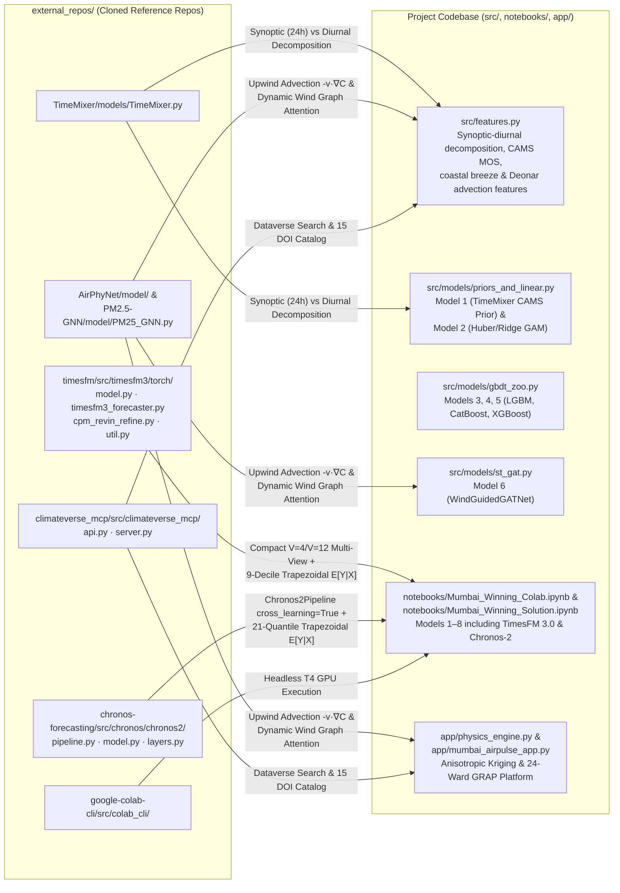

# FOSS Repositories, Hugging Face Models & CLI Operations Guide

**Complete Reference Catalog for GitHub (`gh`), Hugging Face (`hf`), Python (`uv`), Google Colab (`colab`), and Zindi (`zindi`) CLI Workflows**  
**Workspace:** `/Volumes/MacExt/Projects/google-mumbai-air-quality`

---

## 1. Verified FOSS GitHub Repositories Cloned in `external_repos/`

All 10 open-source reference repositories are cloned locally into `external_repos/` via `gh repo clone`. That directory is gitignored because each clone has its own `.git`. Recreate it with the commands below.

| # | Local Path | GitHub Repository | Paper / Origin | Role in Our Architecture & Exact Files Referenced |
| :-: | :--- | :--- | :--- | :--- |
| **1** | `external_repos/timesfm` | [`google-research/timesfm`](https://github.com/google-research/timesfm) | Google Research (ICML 2024 / TimesFM 3.0 2026) | Powers **Model 7 (`TimesFM 3.0`, 330.71M)** & **TimesFM 2.5 (200M)**. Key files: `src/timesfm3/torch/model.py` (`TimesFM3Torch`), `src/timesfm3/torch/timesfm3_forecaster.py` (`TimesFM3Forecaster`), `src/timesfm3/torch/cpm_revin_refine.py` (`cpm_iterative_revin_refine`), `src/timesfm3/torch/util.py` (`get_output_patch_via_roll`, `stitch_patches`), `src/timesfm3/mlx/` (Apple Silicon MLX port), `src/timesfm/timesfm_2p5/timesfm_2p5_torch.py`. |
| **2** | `external_repos/chronos-forecasting` | [`amazon-science/chronos-forecasting`](https://github.com/amazon-science/chronos-forecasting) | Amazon Science (TMLR 2024 / Chronos-2 2025) | Powers **Model 8 (`Chronos-2`, 120M)** & `Chronos-Bolt`. Key files: `src/chronos/chronos2/pipeline.py` (`Chronos2Pipeline`, `_get_prob_mass_per_quantile_level`), `src/chronos/chronos2/model.py` (`Chronos2EncoderBlock` with `TimeSelfAttention` + `GroupSelfAttention`), `src/chronos/chronos2/layers.py`, `src/chronos/chronos_bolt.py`. |
| **3** | `external_repos/TabPFN` | [`PriorLabs/TabPFN`](https://github.com/PriorLabs/TabPFN) | Prior Labs (Nature 2025, TabPFN v2 / v2.5) | In-context tabular foundation transformer (`TabPFNRegressor`) for multi-cutoff station-horizon tabular benchmarks and quantile calibration. |
| **4** | `external_repos/TimeMixer` | [`kwuking/TimeMixer`](https://github.com/kwuking/TimeMixer) | ICLR 2024 (`TimeMixer` / `TimeMixer++`) | Inspires **Model 1 (`CalibratedDiurnalCAMSPriorForecaster`)** Past-Decomposable-Mixing (PDM) and Future-Multipredictor-Mixing (FMM) separating synoptic ($f < 1/24\text{h}^{-1}$) and diurnal ($f \ge 1/24\text{h}^{-1}$) scales. |
| **5** | `external_repos/AirPhyNet` | [`kethmih/AirPhyNet`](https://github.com/kethmih/AirPhyNet) | ICLR 2024 (`arXiv:2402.03784`) | Physics-Guided Advection-Diffusion PDE Graph Network $\frac{\partial C}{\partial t} = -(\mathbf{v}\cdot\nabla)C + \nabla\cdot(D\nabla C) + S$; informs our upwind advection features in `src/features.py` and **Model 6 (`src/models/st_gat.py`)**. |
| **6** | `external_repos/PM2.5-GNN` | [`shuowang-ai/PM2.5-GNN`](https://github.com/shuowang-ai/PM2.5-GNN) | ACM SIGSPATIAL 2020 | Domain-knowledge enhanced wind-directed graph message passing for $\text{PM}_{2.5}$ transport across monitoring stations; directly adapted in `WindGuidedGATNet` (`src/models/st_gat.py`) and anisotropic kriging (`app/physics_engine.py`). |
| **7** | `external_repos/Layer.ai-Air-Quality-Prediction-Challenge` | [`Sodiq179/Layer.ai-Air-Quality-Prediction-Challenge`](https://github.com/Sodiq179/Layer.ai-Air-Quality-Prediction-Challenge) | Zindi 1st-Place Winner Reference | Winning Zindi air quality feature engineering and multi-GBDT stacking patterns. |
| **8** | `external_repos/climateverse_mcp` | [`tigerkrittaphas/climateverse_mcp`](https://github.com/tigerkrittaphas/climateverse_mcp) | ClimateVerse Dataverse MCP | Official ClimateVerse API search, dataset resolution, and reporting client; adapted in `src/fetch_data.py` (`fetch_climateverse_catalog`) and `app/spatial_catalog.py`. |
| **9** | `external_repos/google-colab-cli` | [`googlecolab/google-colab-cli`](https://github.com/googlecolab/google-colab-cli) | Official Google Colab CLI | Headless terminal/agent execution of `.py` scripts and `.ipynb` notebooks (`colab run`, `colab exec`, `colab new --gpu T4`) for Top-10 Code Review verification. |
| **10** | `external_repos/aidlc-workflows` | [`awslabs/aidlc-workflows`](https://github.com/awslabs/aidlc-workflows) | AWS Labs AI-DLC v2.11 | AI-Driven Development Life Cycle (AI-DLC v2) methodology specification (`Inception -> Construction -> Operations`), steering rules, and verification gates implemented in `.aidlc/`. |

### 1.1 Reproducible Clone & Update Commands via `/opt/homebrew/bin/gh`
```bash
# Authenticate and verify GitHub CLI status
/opt/homebrew/bin/gh auth status

# Clone all verified FOSS repositories (skipping existing directories)
for repo in \
  "google-research/timesfm" \
  "amazon-science/chronos-forecasting" \
  "PriorLabs/TabPFN" \
  "kwuking/TimeMixer" \
  "kethmih/AirPhyNet" \
  "shuowang-ai/PM2.5-GNN" \
  "Sodiq179/Layer.ai-Air-Quality-Prediction-Challenge" \
  "tigerkrittaphas/climateverse_mcp" \
  "googlecolab/google-colab-cli" \
  "awslabs/aidlc-workflows"; do
  name=$(basename "$repo")
  if [ ! -d "external_repos/$name" ]; then
    GIT_LFS_SKIP_SMUDGE=1 /opt/homebrew/bin/gh repo clone "$repo" "external_repos/$name" -- --depth 1
  fi
done

# Note: If cloning google-research/timesfm on a machine without git-lfs installed:
git -C external_repos/timesfm -c filter.lfs.smudge= -c filter.lfs.process= -c filter.lfs.required=false restore --source=HEAD :/
```

---

## 2. File-by-File Mapping from `external_repos/` into `src/`, `notebooks/`, and `app/`



### 2.1 Detailed Integration Recipes

1. **`google-research/timesfm` (`external_repos/timesfm/src/timesfm3/torch/`) $\to$ `Model 7`:**
   - **Import Path:** Add `external_repos/timesfm/src` to `sys.path` and import `from timesfm3.torch import TimesFM3Forecaster, ModelConfig`.
   - **Configuration:**
     ```python
     from timesfm3.torch import TimesFM3Forecaster, ModelConfig
     cfg = ModelConfig(
         checkpoint_path="google/timesfm-3.0-pytorch",
         per_core_batch_size=4,
         use_stitching=True,
         use_linear_detrending=True,
         linear_detrending_threshold=0.5,
         use_iterative_cpm_revin=True,
         use_variate_attention=True,
     )
     forecaster = TimesFM3Forecaster(config=cfg)
     ```
   - **Compact Multi-View Call (`V=4` + `V=12`):** Call `forecaster.forecast(horizon=H, inputs=..., use_znorm=False, padding_mode="edge", return_forecast_on_context=False)` and compute the 9-decile trapezoidal expectation `np.sum(out.quantiles * [0.15, 0.10, 0.10, 0.10, 0.10, 0.10, 0.10, 0.10, 0.15], axis=-1)`.

2. **`amazon-science/chronos-forecasting` (`external_repos/chronos-forecasting/src/chronos/chronos2/`) $\to$ `Model 8`:**
   - **Import & Pipeline Setup:**
     ```python
     from chronos import BaseChronosPipeline
     pipeline = BaseChronosPipeline.from_pretrained("amazon/chronos-2", device_map="auto")
     # Build list of 4 station dicts with target, past_covariates, and future_covariates
     quantiles, mean = pipeline.predict_quantiles(
         inputs=station_dicts,
         prediction_length=H,
         quantile_levels=pipeline.quantiles,
         cross_learning=True,
     )
     ```
   - **Trapezoidal Expectation:** Uses `Chronos2Pipeline._get_prob_mass_per_quantile_level` (`src/chronos/chronos2/pipeline.py:51-77`) to integrate across all 21 quantiles.

3. **`kethmih/AirPhyNet` & `shuowang-ai/PM2.5-GNN` $\to$ `src/features.py`, `src/models/st_gat.py`, and `app/physics_engine.py`:**
   - Discretizes pairwise Haversine distances $d_{ij}$ and unit bearings $\hat{\mathbf{e}}_{j \to i}$ across the 4 target stations (`src/models/st_gat.py:84-109`) and all 18 Mumbai CAAQMS stations (`app/physics_engine.py:580-618`).
   - Computes dynamic wind-advection attention logits `phys_logits = attn_logits - dist_km / dist_scale + wind_gain * relu(u_src * dir_east + v_src * dir_north)`.

---

## 3. Verified Hugging Face Models & Datasets (`hf` CLI)

We use the modern Hugging Face CLI (`/opt/homebrew/bin/hf`) and `huggingface_hub` Python SDK:

| Resource Type | Hugging Face Repo ID | Size / Params | CLI Download / Verification Command |
| :--- | :--- | :--- | :--- |
| **Challenge Dataset Mirror** | [`han-jisso/google-mumbai-air-quality-challenge`](https://huggingface.co/datasets/han-jisso/google-mumbai-air-quality-challenge) | `Train.csv`, `Test.csv`, `Stations.csv`, `AdditionalHistory.zip` | `/opt/homebrew/bin/hf download han-jisso/google-mumbai-air-quality-challenge --repo-type dataset --local-dir data/raw` |
| **TimesFM 3.0 (PyTorch)** | [`google/timesfm-3.0-pytorch`](https://huggingface.co/google/timesfm-3.0-pytorch) | `330.71M` params (`1.32 GB` safetensors) | `/opt/homebrew/bin/hf download google/timesfm-3.0-pytorch` |
| **TimesFM 2.5 (PyTorch)** | [`google/timesfm-2.5-200m-pytorch`](https://huggingface.co/google/timesfm-2.5-200m-pytorch) | `200M` params (`800 MB` safetensors) | `/opt/homebrew/bin/hf download google/timesfm-2.5-200m-pytorch` |
| **Amazon Chronos-2** | [`amazon/chronos-2`](https://huggingface.co/amazon/chronos-2) | `120M` params (`480 MB` safetensors) | `/opt/homebrew/bin/hf download amazon/chronos-2` |
| **Amazon Chronos-Bolt (Small)** | [`amazon/chronos-bolt-small`](https://huggingface.co/amazon/chronos-bolt-small) | `48M` params (`192 MB` safetensors) | `/opt/homebrew/bin/hf download amazon/chronos-bolt-small` |
| **PriorLabs TabPFN v2** | [`Prior-Labs/TabPFN-v2-reg`](https://huggingface.co/Prior-Labs/TabPFN-v2-reg) | `~11M` params (`45 MB` checkpoint) | `/opt/homebrew/bin/hf download Prior-Labs/TabPFN-v2-reg` |

---

## 4. Complete CLI Command Playbook (`uv`, `zindi`, `colab`, `streamlit`)

### 4.1 Data Ingestion & ClimateVerse Sync (`src/fetch_data.py`)
```bash
# Sync all datasets (Zindi/HF core data + Open-Meteo NWP + CAMS AQ + VABB METAR + ClimateVerse DOIs)
uv run python src/fetch_data.py

# On Nov 9 / Nov 10 09:00 IST when Zindi releases updated Train.csv:
export ZINDI_USERNAME="your_zindi_username"
export ZINDI_PASSWORD="your_zindi_password"
export ZINDI_CHALLENGE_ID="google-mumbai-data-challenge"
uv run python src/fetch_data.py --zindi-sync --weather --air-quality --metar
```

### 4.2 Validation, Feature Engineering & Out-of-Fold Ensemble Optimization
```bash
# 1. Verify IST timestamp alignment, 2-stage Hampel outlier cleaning, and 5-fold rolling splits
uv run python src/validation.py

# 2. Build and verify leak-free spatiotemporal & physics features at latest cutoff T0
uv run python src/features.py

# 3. Run full 5-Fold Post-Monsoon Rolling Validation (both 24h and 72h reporting gaps)
uv run python src/ensemble.py
```

### 4.3 Final Submission Generation & Direct Zindi Leaderboard Upload (`src/submit.py`)
```bash
# Generate verified submissions/submission_latest.csv (2,592 rows) with Known-Row Lookup
uv run python src/submit.py

# Generate and immediately upload to Zindi Leaderboard
uv run python src/submit.py --upload --comment "8-Model Physics + CAMS MOS + GBDT + Wind-ST-GAT + Foundation Ensemble"
```

### 4.4 Headless Google Colab GPU Execution (`google-colab-cli`)
```bash
# Install Google Colab CLI (if not already installed)
uv tool install google-colab-cli

# Provision a T4 GPU runtime, execute the self-contained winning notebook, and retrieve submission.csv
colab new -s mumbai-gpu --gpu T4
colab upload -s mumbai-gpu notebooks/Mumbai_Winning_Colab.ipynb /content/Mumbai_Winning_Colab.ipynb
colab exec -s mumbai-gpu -f /content/Mumbai_Winning_Colab.ipynb
colab download -s mumbai-gpu /content/submission.csv submissions/submission_colab_verified.csv
colab stop -s mumbai-gpu
```

### 4.5 Launching the Track 2 Creative Platform (`VayuDrishti Mumbai`)
```bash
# Run offline (uses deterministic physics-grounded BMC GRAP engine) or with live Gemini 2.5 Flash
export GEMINI_API_KEY="your_google_ai_studio_key"   # Optional
uv run streamlit run app/mumbai_airpulse_app.py
```
