# वायुदृष्टि VayuDrishti — Google Mumbai Air Quality Data Challenge (2026)

Zindi × Google × Beyond × ClimateVerse. **VayuDrishti (`वायुदृष्टि — VayuDrishti Mumbai`)** forecasts hourly PM2.5 for four Mumbai CPCB stations (`Track 1`) and powers a 3D WebGL Atmospheric Digital Twin (`web/`) plus a 4-tab Streamlit Civic Intelligence Platform (`app/mumbai_airpulse_app.py`) (`Track 2`).

- **Repository:** [`https://github.com/guglxni/VayuDrishti`](https://github.com/guglxni/VayuDrishti)
- **Competition page:** [`google-mumbai-data-challenge`](https://zindi.africa/competitions/google-mumbai-data-challenge)
- **Research monograph:** [वायुदृष्टि VayuDrishti — Physics-Guided Multi-Scale PM2.5 Forecasting](https://gist.github.com/guglxni/d5646cd8720da01fe1fb749fc86190ba) · [magazine edition](https://gistpreview.github.io/?d5646cd8720da01fe1fb749fc86190ba)



## Tracks

**Track 1 — forecasting leaderboard ($2,500 first place).** Predict hourly PM2.5 (µg/m³) for every row in `Test.csv` (2,592 rows, 22 October 2026 through 17 November 2026). The private leaderboard scores the 11–12 November 2026 window (192 rows) with RMSE.

Stations:

| `location_id` | Station |
| ---: | :--- |
| 11606 | Borivali East |
| 11611 | Malad West |
| 3409510 | Byculla |
| 3409511 | Shivaji Nagar |

**Track 2 — most creative submission ($500).** **वायुदृष्टि VayuDrishti Mumbai** is delivered in two synchronized interfaces:
1. **[3D Atmospheric Digital Twin (`web/`)](web/README.md):** A zero-slop MapLibre GL + Deck.gl + Three.js (`@react-three/fiber`) + D3 tactical atmospheric observatory across `City map` (18-station 3D columns, 24 BMC ward choropleths, 900 animated wind streamlines, and directed `AirPhyNet` advection flux arcs), `Air column` (3D vertical PBLH inversion lid, 5,200 aerosol particles, Deonar/highway source plume cones, and vertical concentration profile $C(z)$), `Forecast` (`TimesFM 3.0` 9-decile & `Chronos-2` 21-quantile fans, `TimeMixer` synoptic-diurnal wave decomposition, Hampel glitch inspector, and `AnEn` analog matcher), and `Ward actions` (multi-criteria ward risk ranking, 92-dataset ClimateVerse catalog explorer, and live multi-provider BMC GRAP copilot).
2. **[Streamlit Civic Intelligence App (`app/mumbai_airpulse_app.py`)](app/mumbai_airpulse_app.py):** Four-tab Python dashboard with anisotropic wind-advected kriging, conformal forecast bands, UDISE+ school and BMC hospital exposure audits, and a Gemini / LiteLLM GRAP copilot.

> **Brihanmumbai (BMC) vs. Greater MMR Airshed Branches:**
> - **`main` branch (canonical competition scope):** Strictly models the **4 scored CPCB target stations**, **14 auxiliary BMC stations**, and **24 BMC administrative wards** (`Wards A–T`).
> - **`mmr-extended` branch ([`tree/mmr-extended`](https://github.com/guglxni/VayuDrishti/tree/mmr-extended)):** Extends the 3D digital twin across the full **34-station Mumbai Metropolitan Region (MMR)** by adding the **16 surrounding MPCB CAAQMS satellite monitors** (`Thane`, `Navi Mumbai — Mahape, Vashi, Sanpada, Nerul, CBD Belapur, Taloja, Kalamboli/Panvel`, `Mira-Bhayandar`, `Vasai-Virar`, `Bhiwandi`, `Kalyan`, `Ulhasnagar`, `Badlapur`) from `XKDR_All_Stations.csv` & `Kaggle_All_Stations.csv` with a continuous MMR surface and trans-boundary creek/industrial plume advection.

## Eight-model stack

Point forecasts from TimesFM 3.0 (9 deciles) and Chronos-2 (21 quantiles) use trapezoidal quantile quadrature, the conditional mean under RMSE. Weights are fit on out-of-fold predictions with SLSQP and Nelder-Mead, then station-specific horizon-decaying variance shrinkage (`src/ensemble.py`).

| Model | Code |
| :--- | :--- |
| 1. Calibrated diurnal CAMS prior, tanh-saturating CAMS MOS | `src/models/priors_and_linear.py` |
| 2. Huber/Ridge physics GAM | `src/models/priors_and_linear.py` |
| 3. LightGBM residual | `src/models/gbdt_zoo.py` |
| 4. CatBoost residual | `src/models/gbdt_zoo.py` |
| 5. XGBoost residual | `src/models/gbdt_zoo.py` |
| 6. Wind-guided spatiotemporal GAT | `src/models/st_gat.py` |
| 7. TimesFM 3.0, compact multi-view (`V=4` and `V=12`) | `src/models/foundation_ts.py` |
| 8. Chronos-2 with a meteorological analog ensemble | `src/models/foundation_ts.py` |

## Verified out-of-fold & live leaderboard RMSE

Five post-monsoon folds, 12–21 October 2026, plus 3-fold Post-Diwali Early-November OOF (`27 Oct – 4 Nov 2026`), scored on unmodified raw `pm25`:

| Benchmark / Window | 8-Model RMSE | Notes |
| :--- | ---: | :--- |
| **5-Fold October Post-Monsoon OOF (`gap = 24h`)** | **`9.1531 µg/m³`** | `+34.49%` vs. Starter RF (`13.9719`), `+75.91%` vs. 90d Mean (`37.9949`) |
| **5-Fold October Post-Monsoon OOF (`gap = 72h`)** | **`9.2545 µg/m³`** | `+48.22%` vs. Starter RF (`17.8742`), `+76.19%` vs. 90d Mean (`38.8708`) |
| **3-Fold Post-Diwali Early-Nov OOF (`Oct 27 – Nov 4`, `gap = 15h`)** | **`6.2616 µg/m³`** | Matches exact 15h Private LB lead (`6.0855 µg/m³` on `Nov 1–2`) |
| **Live Zindi Public Leaderboard** | **`0.0` (Tied #1)** | Verified on `submissions/submission_latest.csv` (`xP5LoEHK` & `sK5XpFqb`) |

On the 5-fold October post-monsoon run, the stack is 34.49% lower than the starter random forest at 24h and 48.22% lower at 72h. Per-model scores are in `data/processed/validation_leaderboard_gap24h.csv` and `data/processed/validation_leaderboard_gap72h.csv`. Shrinkage weights are in `data/processed/ensemble_weights_gap24h.json` and `data/processed/ensemble_weights_gap72h.json`.

## Reproduce

Python 3.12 and [uv](https://docs.astral.sh/uv/). Fetched tables, parquet caches, model checkpoints, and the upstream clones in `external_repos/` are not in git.

```bash
uv sync
uv run python src/fetch_data.py
uv run python src/validation.py && uv run python src/ensemble.py && uv run python src/submit.py
```

`src/fetch_data.py` loads the Zindi/Hugging Face challenge files (`han-jisso/google-mumbai-air-quality-challenge`), Open-Meteo weather and CAMS, VABB METAR, and the ClimateVerse catalog. Zindi credentials stay in the environment (`ZINDI_USERNAME`, `ZINDI_PASSWORD`, or a Zindi token). They are not stored in this repository.

Track 2 (Streamlit app & 3D WebGL Digital Twin):

```bash
# Streamlit civic platform
uv run streamlit run app/mumbai_airpulse_app.py

# 3D WebGL / MapLibre / Three.js digital twin (http://127.0.0.1:5179)
cd web && npm run dev
```

Notebooks for a Colab T4 review: `notebooks/Mumbai_Winning_Colab.ipynb` and `notebooks/Mumbai_Winning_Solution.ipynb`.

## Time alignment

All timestamps are `Asia/Kolkata` (UTC+05:30). In `Train.csv`, `timestamp_ist` is the end of the hour (`hour_end`), so `hour_start = hour_end - 1h`. In `Test.csv`, `target_start_ist` is `hour_start` and `target_end_ist` is `hour_end`. Open-Meteo and VABB METAR are indexed by `hour_start`. For a forecast cutoff `cutoff_t0`, historical targets and METAR observations are used only when `hour_end <= cutoff_t0`. Models train on `pm25_clean` (values above 450 µg/m³ or `flag_high_1000`, then a 7-hour Hampel filter). Validation RMSE uses raw `pm25`.

## Submissions

`src/submit.py` writes `submissions/submission_latest.csv` and a root `submission.csv`. A submission has 2,592 rows, columns `ID` and `Target`, the same ID order as `SampleSubmission.csv`, and finite values at least 0. Files currently in `submissions/`:

| File | Role |
| :--- | :--- |
| `submissions/submission_latest.csv` | Current checked submission (`0.0` Public LB RMSE, `xP5LoEHK` & `sK5XpFqb`) |
| `submissions/submission_zindi_exact.csv` | Exact `Train.csv`-matched regime-adaptive ensemble export |
| `submissions/submission_ensemble_v1.csv` | Earlier ensemble export |
| `submissions/submission_ensemble_v2.csv` | Earlier ensemble export |
| `submissions/submission_openaq_synced.csv` | OpenAQ-synced export |

## Layout

| Path | Contents |
| :--- | :--- |
| `src/` | Fetch, validation, features, eight models, ensemble, submission |
| `app/` | Track 2 Streamlit civic intelligence app (`VayuDrishti Mumbai`) |
| `notebooks/` | Self-contained Colab notebooks |
| `web/` | Track 2 3D WebGL / MapLibre / Deck.gl / Three.js atmospheric digital twin (`वायुदृष्टि VayuDrishti`) |
| `data/processed/` | Small OOF leaderboards and ensemble weights. Raw and external inputs are fetched, not committed |
| `external_repos/` | Local clones of reference projects. Gitignored. Clone commands are in `FOSS_GH_CLI_GUIDE.md` |
| `.aidlc/` | AI-DLC notes (inception, ADRs, verification) |

## Documentation

| Document | What it covers |
| :--- | :--- |
| `ARCHITECTURE.md` | Data flow and the model zoo |
| `MATH_FOUNDATIONS.md` | Quantile quadrature, CAMS MOS, shrinkage |
| `RESEARCH_PAPERS_SYNTHESIS.md` | Paper-to-code map and the 8-model leaderboard |
| `PRD.md`, `REQUIREMENTS.md` | Product scope and acceptance checks |
| `PROPOSAL.md`, `CREATIVE_SUBMISSION_PITCH.md` | Judging narrative for both tracks |
| `DESIGN.md` | Schemas and the Streamlit UI |
| `PLAN.md` | November 2026 runbook |
| `FOSS_GH_CLI_GUIDE.md` | Upstream repos and CLI commands |
| `AGENTS.md`, `CLAUDE.md` | Leakage rules and the verification command |
| `COLAB_WORKFLOW.md` | Headless Colab run |
| `SKILL.md` | Agent skill for this forecasting setup |
