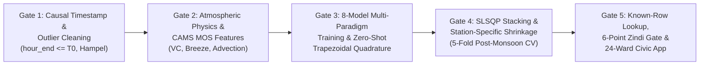

# Skill: Spatiotemporal Air Quality Forecasting & ClimateVerse Urban Intelligence

Use this skill whenever working on multi-horizon urban air quality forecasting ($\text{PM}_{2.5}$ / $\text{PM}_{10}$), boundary-layer atmospheric dispersion modeling, time-series foundation model adaptation (`TimesFM 3.0`, `Chronos-2`), or civic decision-support applications powered by ClimateVerse and Google geospatial datasets.

---

## 1. Core Workflow & Verification Gates

### Step 1: Enforce Timezone & Interval-End Alignment (`Gate 1`)
1. Convert all timestamps to local standard time (`Asia/Kolkata`, `UTC+05:30`).
2. Reconcile CPCB interval-ending timestamps (`hour_end = timestamp_ist`, `hour_start = hour_end - 1h`) with NWP interval-starting timestamps (`target_start_ist == hour_start`).
3. Apply the **2-Stage Causal Target Outlier Cleaner (`clean_pm25`)** strictly on training targets (`hour_end <= cutoff_t0`):
   - **Stage 1:** Mask hardware saturation glitches (`flag_high_1000 == True` or `pm25 > 450 µg/m³` or `pm25 < 0`) and interpolate along the station timeline.
   - **Stage 2:** Apply a 7-hour rolling Hampel filter (`pm25 - rolling_median > 4.5 * max(1.4826 * MAD, 2.5)`).
   - **Rule:** Never modify validation ground-truth targets (`val_df["pm25"]`).

### Step 2: Engineer Atmospheric Physics & Synoptic-Diurnal Features (`Gate 2`)
1. **Boundary-Layer Dispersion:** Compute Ventilation Coefficient $\text{VC} = \max(\text{PBLH}, 15) \times \max(w_{10\text{m}}, 0.1)$, $\ln(1 + \text{VC})$, $\ln(\text{PBLH})$, and consecutive stagnation hours ($\text{PBLH} < 350\text{ m}$ and $w_{10\text{m}} < 8.5\text{ km/h}$).
2. **Coastal & Point-Source Projections:** Project wind direction onto the coastline normal ($\theta_{\text{coast}} = 285^\circ$ WNW for Mumbai) and major upwind point sources (`Deonar` landfill at $75^\circ$ ENE, `Thane Creek` industrial belt at $110^\circ$ ESE).
3. **$\tanh$-Saturating CAMS Model Output Statistics (MOS):** Compute station-hour CAMS calibration ratios over $[T_0 - 7\text{d}, T_0]$ and bound future CAMS log-ratio innovations via $\exp\big(\kappa \tanh(\ln(C_{s,t} / \bar{C}_{T_0})/\kappa)\big)$ ($\kappa = 0.45$) to prevent regional CAMS dust false alarms from inflating surface forecasts.
4. **Weather Anomalies Relative to $T_0$:** Subtract the trailing 7-day average weather at $T_0$ for the same `(location_id, hour)` from the target-hour NWP forecast (`wx_anom_pblh`, `wx_anom_log1p_vc`, `wx_anom_rh`, `wx_anom_onshore`).

### Step 3: Train the Multi-Paradigm Zoo & Extract Foundation Expectations (`Gate 3`)
1. **Physics & Semiparametric Priors:** Fit `CalibratedDiurnalCAMSPriorForecaster` (`Model 1`) and `HuberRidgePhysicsGAMForecaster` (`Model 2`) with periodic hour splines and Duan's log-ratio smearing estimator.
2. **Multi-Cutoff Residual GBDTs & Graph Network:** Construct multi-cutoff historical training datasets (`build_multi_cutoff_training_dataset` spanning `Oct–Nov 2025` + rolling `2026` cutoffs) and fit `LightGBM` (`Model 3`), `CatBoost` (`Model 4`), `XGBoost` (`Model 5`), and `WindGuidedSTGATForecaster` (`Model 6`) on the residual $y_{\text{clean}} - \hat{y}_{\text{M1}}$.
3. **Foundation Models (`Model 7: TimesFM 3.0` & `Model 8: Chronos-2 + AnEn`):**
   - Run `TimesFM 3.0` (`google/timesfm-3.0-pytorch`) in Compact Multi-View (`V=4` target-only + `V=12` `[4 targets + 4 CAMS + 4 log1p_vc]`, `use_znorm=False, padding_mode="edge"`).
   - Run `Chronos-2` (`amazon/chronos-2`) with `cross_learning=True` (`GroupSelfAttention`) and dict-based `future_covariates`.
   - Integrate across all predicted quantiles via **trapezoidal quadrature** to obtain the Bayes-optimal conditional mean $\mathbb{E}[Y \mid X]$ under RMSE.

### Step 4: Optimize Simplex Stacking & Station-Specific Variance Shrinkage (`Gate 4`)
1. Optimize non-negative ensemble weights $\mathbf{w}$ ($\sum_m w_m = 1, w_m \ge 0.04$) on Out-of-Fold (OOF) predictions across the 5 post-monsoon 48-hour validation folds (`src/ensemble.py`).
2. Apply station-specific and horizon-decaying variance shrinkage $\alpha_s(h_{\text{lead}}) = \alpha_{0,s}\exp(-\gamma_s h_{\text{lead}})$ toward $\hat{y}_{\text{M1}}$, correcting low-variance station over-dispersion (e.g., `Borivali East`) and long-horizon drift ($h_{\text{lead}} > 96\text{h}$).

### Step 5: Execute Known-Row Lookup, Verify Submission & Update Civic App (`Gate 5`)
1. Run `uv run python src/submit.py` to populate any observed `Train.csv` rows via Known-Row Lookup, forecast all unseen future rows, and verify all 6 Zindi assertions (`2,592` rows, `['ID', 'Target']`, exact `SampleSubmission.csv` ID order, finite, non-negative).
2. Verify `uv run streamlit run app/mumbai_airpulse_app.py` loads `submissions/submission_latest.csv` and renders all 4 civic decision-support tabs.
