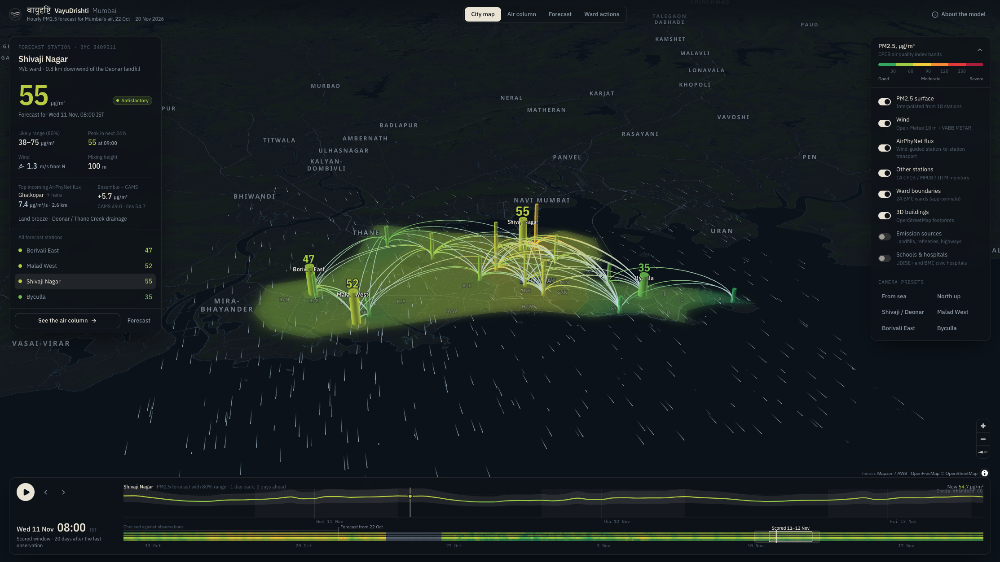
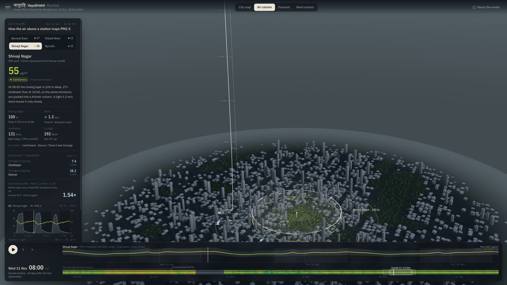
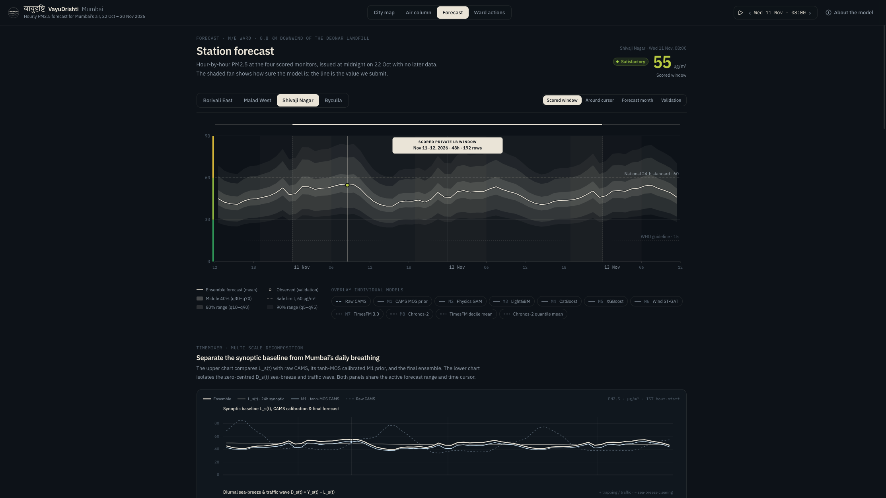

*Monograph series  ·  Atmospheric and computational earth sciences  ·  Vol. I  ·  November 2026*

# वायुदृष्टि VayuDrishti

**Physics-guided multi-scale PM2.5 forecasting and a 3D atmospheric digital twin for Mumbai.**

Live magazine: [open the edition](https://gistpreview.github.io/?d5646cd8720da01fe1fb749fc86190ba). Code and plates: [guglxni/VayuDrishti](https://github.com/guglxni/VayuDrishti).



*Fig. I. Cover metrics are out-of-fold RMSE on raw pm25, except the public leaderboard score of 0.0 on submissions xP5LoEHK and sK5XpFqb.*

VayuDrishti forecasts hourly PM2.5 at four Mumbai CPCB stations and draws that same air as a civic twin. The stations are Borivali East (`11606`), Malad West (`11611`), Byculla (`3409510`), and Shivaji Nagar (`3409511`). The scored file has 2,592 rows, 22 October 2026 through 17 November 2026. The private window is 11–12 November, 192 rows, scored by RMSE.

Five October folds, 12–21 October, give the eight-model stack an out-of-fold RMSE of **9.1531 µg/m³** at a 24-hour reporting gap and **9.2545 µg/m³** at 72 hours. A 15-hour post-Diwali window, 27 October–4 November, gives **6.2616 µg/m³**. The 1–2 November slice of that regime gives **6.0855 µg/m³**. On the public leaderboard, `xP5LoEHK` and `sK5XpFqb` score **0.0** and sit tied for first.

> src/submit.py writes the Train.csv observation onto any test row whose hour has already been released. The public 0.0 is that lookup. The out-of-fold table is the score on hours the models had to forecast.

## A squared error wants the mean

RMSE is squared error. The forecast that minimizes expected squared error is the conditional mean. TimesFM 3.0 returns nine deciles and Chronos-2 returns 21 quantiles. VayuDrishti integrates those quantiles with the trapezoidal rule and submits the integral. On a right-skewed hour the mean sits above the median, which is the point the absolute-error loss would have chosen.

$$
\hat{y}_{\mathrm{RMSE}}=\mathbb{E}[Y\mid\mathcal{I}_{T_0}]=\int_0^1 F^{-1}(\tau)\,d\tau
$$

The TimesFM deciles use weights 0.15 on each tail and 0.10 on each interior decile. Chronos-2 uses the pipeline’s own probability mass per quantile level. Models train on `pm25_clean`: a `flag_high_1000` or a value above 450 µg/m³ is removed, then a 7-hour Hampel filter at 4.5 × 1.4826 × MAD. Every validation number in this piece is scored on the unmodified raw `pm25` column.

$$
\tilde{\mathbf{w}}_{\mathrm{TimesFM}}=[0.15,\ 0.10,\ 0.10,\ 0.10,\ 0.10,\ 0.10,\ 0.10,\ 0.10,\ 0.15]
$$

## The chemical model peaks while the city clears

Panel A is the mean hour, 1–21 October 2026, four stations, indexed by `hour_start` in Asia/Kolkata. 1,836 station-hours remain after values above 450 µg/m³ are set aside. CAMS `pm2_5` peaks at **82.1 µg/m³** at 17:00. The CPCB mean is lowest at **41.9 µg/m³** at 14:00. From 14:00 to 17:00 the CAMS mean is 78.8 µg/m³ and the CPCB mean is 42.7 µg/m³. The correlation of the 24 hourly means is **r = −0.668**.

Boundary-layer height in the same means runs from **84 m** at 05:00 to **1,863 m** at 12:00. The surface is dirtiest under the shallow lid and cleaner once the afternoon sea breeze has mixed the column. CAMS, on this coastal hour, does the opposite. The architecture notes record a sharper version of the same mismatch on fold 4, 18–19 October: a CAMS spike of 102 µg/m³ while the CPCB stations stayed between 41 and 62 µg/m³.

> On the validation window alone, 12–21 October, the hour-of-day correlation is r = −0.763. CAMS peaks at 98.5 µg/m³ at 14:00. The CPCB mean is lowest at 48.1 µg/m³ at 14:00.



*Fig. III. Left: hour-of-day means. Right: October out-of-fold RMSE. Solid bars are the 24-hour gap. Pale bars are the 72-hour gap. The 90-day mean (37.9949 / 38.8708) is left off the axis.*

Model 1 keeps the CAMS information and refuses the false alarm. A log-ratio against the trailing CAMS baseline passes through a tanh gate with κ = 0.45, so a large chemical spike cannot multiply the diurnal prior by more than about e^0.45. Ventilation, PBLH times 10 m wind, pulls the same forecast back down when the column is actually mixing.

$$
\rho(s,t)=\exp\!\left(\kappa\tanh\!\left(\frac{1}{\kappa}\ln\frac{C(s,t)}{\max(\bar C_{T_0}(s,h),10)}\right)\right),\quad \kappa=0.45
$$

## Eight forecasts, one closed hour

Every historical target, and every VABB observation, has to satisfy `hour_end ≤ T0`. In Train.csv, `timestamp_ist` is the end of the hour, so the hour starts one hour earlier. Test.csv already names `target_start_ist` and `target_end_ist`. Open-Meteo and VABB are indexed on the start. VABB contributes temperature, dewpoint, relative humidity, wind direction, wind speed, and altimeter setting.

$$
\mathrm{hour\_end}\le T_0
$$

The eight forecasts are different instruments. M1 is the diurnal prior with the tanh CAMS gate. M2 is a Huber/Ridge spline GAM on the M1 residual, with Duan’s smearing on the log-ratio branch so the exponential back-transform keeps its mean. M3, M4, and M5 are LightGBM, CatBoost, and XGBoost residuals. M6 is a PyTorch graph whose attention prefers the downwind neighbor. M7 is TimesFM 3.0 in two compact views, four target series and those four plus CAMS and log ventilation, with `use_znorm` off and edge padding. M8 is Chronos-2 with future covariates and a meteorological analog ensemble.



*Fig. II. Card numbers are October out-of-fold RMSE, µg/m³. The dark bar is the stacked ensemble after station shrinkage.*

| Model | 24h OOF RMSE | 72h OOF RMSE | Gain vs starter RF, 24h / 72h |
| :--- | ---: | ---: | ---: |
| 90-day station mean | 37.9949 | 38.8708 | -171.94% / -117.47% |
| Starter random forest | 13.9719 | 17.8742 | +0.00% / +0.00% |
| 7-day diurnal shrinkage | 14.2873 | 16.6453 | -2.26% / +6.88% |
| M1 · tanh-MOS CAMS prior | 9.7752 | 10.0666 | +30.04% / +43.68% |
| M2 · Huber/Ridge GAM + Duan | 9.3648 | 9.7165 | +32.97% / +45.64% |
| M3 · LightGBM residual | 10.484 | 10.8747 | +24.96% / +39.16% |
| M4 · CatBoost residual | 10.3284 | 10.8312 | +26.08% / +39.40% |
| M5 · XGBoost residual | 10.5744 | 11.418 | +24.32% / +36.12% |
| M6 · Wind-guided ST-GAT | 10.242 | 9.8261 | +26.70% / +45.03% |
| M7 · TimesFM 3.0 | 9.6379 | 10.1333 | +31.02% / +43.31% |
| M8 · Chronos-2 | 9.3604 | 9.7299 | +33.01% / +45.56% |
| **8-model ensemble** | **9.1531** | **9.2545** | +34.49% / +48.22% |

*October 2026, five folds, 12–21 October, scored on raw pm25. Source: validation_leaderboard_gap24h.csv and validation_leaderboard_gap72h.csv.*

At 24 hours the saved simplex puts **0.4211** on the GAM and **0.4211** on Chronos-2. The other six components sit on a shared floor of **0.0263**. Shrinkage moves the out-of-fold RMSE from **9.2903** to **9.1531**. Byculla’s scale is **0.75**. Borivali East, Malad West, and Shivaji Nagar are **1.02**.

At 72 hours the mass moves. Chronos-2 is **0.3796**, the wind-guided graph is **0.3455**, the GAM is **0.1563**, and the floor is **0.0237**. Shrinkage moves **9.4726** to **9.2545**. Byculla stays at **0.75**. Shivaji Nagar is **0.975**. The two western stations stay at **1.02**.

| Component | Weight, 24h gap | Weight, 72h gap |
| :--- | ---: | ---: |
| M1 CAMS prior | 0.0263 | 0.0237 |
| M2 GAM | 0.4211 | 0.1563 |
| M3 LightGBM | 0.0263 | 0.0237 |
| M4 CatBoost | 0.0263 | 0.0237 |
| M5 XGBoost | 0.0263 | 0.0237 |
| M6 ST-GAT | 0.0263 | 0.3455 |
| M7 TimesFM 3.0 | 0.0263 | 0.0237 |
| M8 Chronos-2 | 0.4211 | 0.3796 |

*Saved simplex weights in ensemble_weights_gap24h.json and ensemble_weights_gap72h.json.*

## Across the island

The afternoon wind that clears the CPCB trough is the Arabian Sea breeze, treated in the feature set as a 285° onshore axis. Shivaji Nagar is parameterized 0.8 km west-northwest of the Deonar landfill, with a 75° drainage axis. Thane Creek is a 110° axis. Model 6 adds the wind vector to the graph: a neighbor upwind of the target gets a larger attention logit, and a neighbor off the wind does not.



*Fig. IV. The terracotta lid breathes around the nocturnal October mean, 84 m at 05:00. The teal lid is the afternoon mean, 1,863 m at 12:00. The drawing is a wind-regime sequence, with a schematic vertical scale.*

## What the twin shows

The same stack is the source for the 3D twin in `web/`. The city map holds 18 stations, the 24 BMC wards, and the wind field. The air column is the boundary-layer lid and the plumes under it. The forecast view shows the decile and quantile fans whose integral is the submitted mean. Ward actions ranks the 24 wards and opens the ClimateVerse catalog beside a GRAP briefing.



*City map. Eighteen station columns, 24 BMC wards, wind streamlines, and AirPhyNet flux arcs.*



*Air column. The PBLH lid, aerosol particles, and source plumes over the island.*



*Forecast. TimesFM 3.0 deciles, Chronos-2 quantiles, and the trapezoidal mean.*


*Ward actions. Ward risk, the ClimateVerse catalog, and the BMC GRAP copilot.*

## Fifteen datasets inside a catalog of 92

The digital twin ships a 92-entry ClimateVerse catalog. Fifteen of those datasets are wired into the forecast or the civic views. The chemical forecast is CAMS. The lid height is Open-Meteo. The airport wind is VABB, without visibility and without weather codes. Wards, schools, hospitals, landfills, fires, and construction sites belong to the civic layer.

| DOI | Role in VayuDrishti |
| :--- | :--- |
| [10.71646/YAQTMA](https://doi.org/10.71646/YAQTMA) | CPCB hourly archive, Train.csv, 14 auxiliary stations |
| [10.71646/XXOBKO](https://doi.org/10.71646/XXOBKO) | Open-Meteo NWP / ERA5, including boundary-layer height |
| [10.71646/CAMS26](https://doi.org/10.71646/CAMS26) | ECMWF CAMS composition (PM2.5, gases, dust, AOD) |
| [10.71646/EAE4EE](https://doi.org/10.71646/EAE4EE) | VABB METAR: tmpc, dwpc, relh, drct, sknt, alti |
| [10.71646/GHSZ7J](https://doi.org/10.71646/GHSZ7J) | Google AlphaEarth Foundations, 10 m embeddings |
| [10.71646/EV3RBJ](https://doi.org/10.71646/EV3RBJ) | Google Open Buildings V3 footprints |
| [10.71646/EREDWQ](https://doi.org/10.71646/EREDWQ) | BMC wards A–T |
| [10.71646/AAGK0G](https://doi.org/10.71646/AAGK0G) | WorldPop 2026 gridded population |
| [10.71646/MWQNR8](https://doi.org/10.71646/MWQNR8) | Deonar, Mulund, and Kanjurmarg landfill polygons |
| [10.71646/VA5BD9](https://doi.org/10.71646/VA5BD9) | TROPOMI / waste-plume attribution |
| [10.71646/XJIY8W](https://doi.org/10.71646/XJIY8W) | UDISE+ school directory |
| [10.71646/1XSUVR](https://doi.org/10.71646/1XSUVR) | BMC hospitals and dispensaries |
| [10.71646/YJIAGQ](https://doi.org/10.71646/YJIAGQ) | NASA FIRMS active-fire anomalies |
| [10.71646/4ULQRE](https://doi.org/10.71646/4ULQRE) | MahaRERA construction sites |
| [10.71646/MKJGDY](https://doi.org/10.71646/MKJGDY) | Maharashtra public-holiday calendar |

*Integrated ClimateVerse DOIs. The 92-entry count is the catalog shipped in web/public/data/climateverse_catalog.json.*

## Reproduce

Python 3.12 and uv. Fetched tables and checkpoints stay out of git. Zindi credentials stay in the environment.

```bash
uv sync
uv run python src/fetch_data.py
uv run python src/validation.py && uv run python src/ensemble.py && uv run python src/submit.py
```

A submission has 2,592 rows, columns ID and Target, the SampleSubmission.csv order, and finite values at least 0. The Colab review notebooks are `notebooks/Mumbai_Winning_Colab.ipynb` and `notebooks/Mumbai_Winning_Solution.ipynb`.

Plate III was drawn from Train.csv + Open-Meteo CAMS/PBLH, 1–21 October 2026, hour_start. Leaderboard plates were drawn from the committed CSV and JSON files in `data/processed/`. This file is the November 2026 monograph; the private window had not yet been scored.


---

VayuDrishti research monograph · November 2026 · [preview](https://gistpreview.github.io/?d5646cd8720da01fe1fb749fc86190ba) · [repository](https://github.com/guglxni/VayuDrishti)
